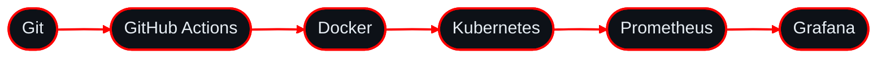

 

  

## ABOUT ME

Focused on **DevOps / Cloud Engineering**

Building systems that are **reliable, scalable & production-ready**

 

## TECH STACK

DEVOPS & CLOUD
 

 

PROGRAMMING
 

 

VERSION CONTROL
 

 

## PIPELINE

 

## CONTACT

<a href="mailto:sandeepkulkarni2003@gmail.com">sandeepkulkarni2003@gmail.com</a>&nbsp;&nbsp;·&nbsp;&nbsp;<a href="tel:+918971748386">+91 8971748386</a>&nbsp;&nbsp;·&nbsp;&nbsp;<a href="https://www.linkedin.com/in/sandeep-kulkarni-b8a69a29a/">LinkedIn</a>

 

---

⚡ **Always learning. Always building.**

